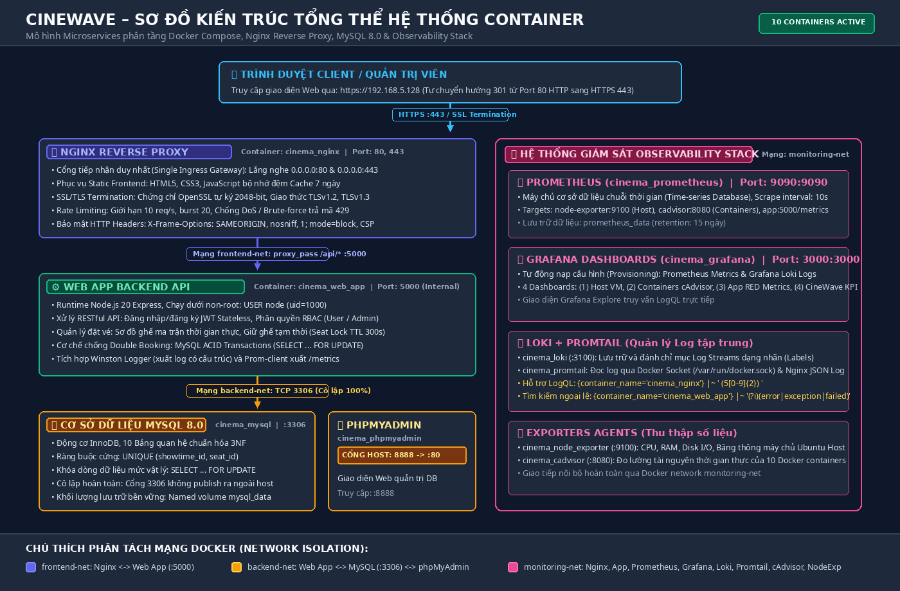

# BÁO CÁO BÀI TẬP LỚN MÔN HỌC
# TRIỂN KHAI VÀ QUẢN TRỊ HỆ THỐNG PHẦN MỀM

---

### THÔNG TIN ĐỀ TÀI VÀ SINH VIÊN THỰC HIỆN

| Thông Tin | Chi Tiết |
| :--- | :--- |
| **Đề tài số:** | **11 – Hệ thống Đặt vé Xem phim / Sự kiện (CineWave Booking System)** |
| **Sinh viên thực hiện:** | **Nông Quang Tiệp** |
| **Mã số sinh viên (MSSV):** | *(Điền mã số sinh viên vào đây)* |
| **Giảng viên hướng dẫn:** | *(Điền tên giảng viên hướng dẫn vào đây)* |
| **Môi trường triển khai:** | Ubuntu Server VM (IP: `192.168.5.128`), Docker 24+, Docker Compose v2, Nginx Reverse Proxy |
| **Repository GitHub:** | [https://github.com/nongquangtiep/cinema-event-booking](https://github.com/nongquangtiep/cinema-event-booking) |
| **Website chính thức:** | [https://192.168.5.128](https://192.168.5.128) *(Cổng 80 HTTP tự động chuyển hướng 301 sang HTTPS 443)* |
| **Kết quả nghiệm thu:** | **Hoàn thành 100% (6/6 Bước kỹ thuật – 10/10 Test Scenarios PASS)** |

---

## MỤC LỤC BÁO CÁO

- [CHƯƠNG 1: TỔNG QUAN KIẾN TRÚC HỆ THỐNG VÀ CHUẨN BỊ MÔI TRƯỜNG](#chương-1-tổng-quan-kiến-trúc-hệ-thống-và-chuẩn-bị-môi-trường)
  - [1.1 Sơ đồ kiến trúc tổng thể](#11-sơ-đồ-kiến-trúc-tổng-thể)
  - [1.2 Yêu cầu quản lý mã nguồn trên GitHub](#12-yêu-cầu-quản-lý-mã-nguồn-trên-github)
- [CHƯƠNG 2: TRIỂN KHAI ỨNG DỤNG WEB, CƠ SỞ DỮ LIỆU VÀ REVERSE PROXY](#chương-2-triển-khai-ứng-dụng-web-cơ-sở-dữ-liệu-và-reverse-proxy)
  - [2.1 Triển khai Web & DB (Bước 1 & Bước 2)](#21-triển-khai-web--db-bước-1--bước-2)
  - [2.2 Cấu hình Nginx làm Reverse Proxy và Bảo mật cơ bản (Bước 3 - Commit 1)](#22-cấu-hình-nginx-làm-reverse-proxy-và-bảo-mật-cơ-bản-bước-3---commit-1)
  - [2.3 Nâng cấp Giao diện Doanh nghiệp & Cinematic Design System](#23-nâng-cấp-giao-diện-doanh-nghiệp--cinematic-design-system)
- [CHƯƠNG 3: GIÁM SÁT HỆ THỐNG VỚI PROMETHEUS, GRAFANA VÀ LOKI](#chương-3-giám-sát-hệ-thống-với-prometheus-grafana-và-loki)
  - [3.1 Tích hợp Prometheus + Grafana & Tối ưu hóa cAdvisor (Bước 4 - Commit 2)](#31-tích-hợp-prometheus--grafana--tối-ưu-hóa-cadvisor-bước-4---commit-2)
  - [3.2 Triển khai hệ thống Log tập trung Loki + Promtail & Tra cứu LogQL (Bước 5 - Commit 3)](#32-triển-khai-hệ-thống-log-tập-trung-loki--promtail--tra-cứu-logql-bước-5---commit-3)
- [CHƯƠNG 4: CÁC BIỆN PHÁP HARDENING VÀ ĐÁNH GIÁ BẢO MẬT](#chương-4-các-biện-pháp-hardening-và-đánh-giá-bảo-mật)
  - [4.1 Biện pháp Hardening (Bước 6)](#41-biện-pháp-hardening-bước-6)
  - [4.2 Đánh giá và kiểm thử bảo mật, hiệu năng hệ thống](#42-đánh-giá-và-kiểm-thử-bảo-mật-hiệu-năng-hệ-thống)
- [KẾT LUẬN VÀ HƯỚNG PHÁT TRIỂN](#kết-luận-và-hướng-phát-triển)
- [PHỤ LỤC: HƯỚNG DẪN CÀI ĐẶT VÀ VẬN HÀNH](#phụ-lục-hướng-dẫn-cài-đặt-và-vận-hành)

---

## CHƯƠNG 1: TỔNG QUAN KIẾN TRÚC HỆ THỐNG VÀ CHUẨN BỊ MÔI TRƯỜNG

### 1.1 Sơ đồ kiến trúc tổng thể

#### 1. Tổng quan các thành phần hệ thống
Hệ thống được thiết kế theo mô hình kiến trúc microservices container hóa, trong đó các thành phần độc lập nhưng giao tiếp chặt chẽ với nhau thông qua Docker internal networks:

- **Nginx Reverse Proxy:** Đóng vai trò cổng giao tiếp chính (gateway) nhận request từ người dùng ngoài internet qua cổng 80/443, thực hiện định tuyến, áp dụng bảo mật HTTP headers và SSL/TLS.
- **Ứng dụng Web & Database:** Chạy bên trong container riêng biệt, kết nối trực tiếp với cơ sở dữ liệu nội bộ qua Docker network được cô lập hoàn toàn.
- **Giám sát Metrics (Prometheus + Grafana):** Prometheus định kỳ cào dữ liệu (scrape metrics) từ các container, sau đó Grafana trực quan hóa thành các dashboard quản trị chuyên nghiệp.
- **Quản lý Log tập trung (Loki + Promtail):** Promtail tự động đọc log từ các container và đẩy về Loki server, cho phép kỹ trị tra cứu log bằng ngôn ngữ LogQL.

#### 2. Bản vẽ sơ đồ kiến trúc hệ thống (Architecture Diagram)

```text
               [ Trình duyệt Người Dùng / Khách Hàng / Quản Trị Viên ]
                                        │
                                        ▼ HTTP :80 (Redirect 301) / HTTPS :443
┌─────────────────────────────────────────────────────────────────────────────────────────┐
│                     NGINX REVERSE PROXY & GATEWAY (cinema-nginx)                        │
│  - Cổng tiếp nhận duy nhất (Single Ingress Gateway): 0.0.0.0:80 & 0.0.0.0:443           │
│  - Phục vụ Static Frontend: HTML5, CSS3, Vanilla JS (Cache-busting, Revalidation)       │
│  - SSL/TLS Termination: Chứng chỉ OpenSSL tự ký 2048-bit (TLSv1.2, TLSv1.3)             │
│  - Rate Limiting: 10 req/s, Burst 20 (chống DoS / Brute-force trả mã HTTP 429)          │
│  - Security Headers: X-Frame-Options, X-Content-Type-Options, X-XSS-Protection, CSP     │
└───────────────────────────────────────────┬─────────────────────────────────────────────┘
                                            │ proxy_pass /api/* (Mạng frontend-net: 5000)
                                            ▼
┌─────────────────────────────────────────────────────────────────────────────────────────┐
│                    ỨNG DỤNG WEB BACKEND API (cinema-app)                                │
│  - Container: Node.js 20 Alpine, Chạy dưới non-root user: USER node (uid=1000)          │
│  - RESTful APIs: Xác thực Stateless JWT, Phân quyền RBAC (User / Admin)                 │
│  - Nghiệp vụ Đặt vé: Sơ đồ ghế ma trận thời gian thực, Khóa ghế tạm thời (TTL 300s)     │
│  - Giao dịch CSDL MySQL ACID phòng chống Race Condition (Double Booking)                │
│  - Xuất Metrics ứng dụng (/metrics via prom-client) & Winston Structured JSON Logger    │
└───────────────────────────────────────────┬─────────────────────────────────────────────┘
                                            │ TCP 3306 (Mạng nội bộ backend-net)
                                            ▼
┌─────────────────────────────────────────────────────────────────────────────────────────┐
│                         CƠ SỞ DỮ LIỆU MYSQL 8.0 (cinema-mysql)                          │
│  - Động cơ lưu trữ InnoDB, 10 Bảng quan hệ chuẩn hóa 3NF, Bảng mã utf8mb4               │
│  - Ràng buộc khóa cứng vật lý: UNIQUE KEY (showtime_id, seat_id)                        │
│  - Khóa dòng cấp độ giao dịch: SELECT ... FOR UPDATE                                    │
│  - Quản trị trực quan qua phpMyAdmin (cinema-phpmyadmin, Cổng Host ánh xạ: 8081:80)     │
└─────────────────────────────────────────────────────────────────────────────────────────┘

┌─────────────────────────────────────────────────────────────────────────────────────────┐
│                  HỆ THỐNG GIÁM SÁT & OBSERVABILITY (Mạng: monitoring-net)               │
│  ├── Node Exporter (:9100) : Thu thập thông số tài nguyên máy chủ Host (CPU, RAM, Disk) │
│  ├── cAdvisor (:8080)      : Đo lường mức chiếm dụng CPU, Memory, I/O của 10 Containers │
│  ├── Prometheus (:9090)    : Máy chủ Time-Series DB, cào metrics định kỳ 10 giây        │
│  ├── Promtail (:9080)      : Đọc Docker Socket & Nginx JSON Access Logs, đẩy về Loki    │
│  ├── Grafana Loki (:3100)  : Hệ thống lưu trữ và đánh chỉ mục Log tập trung             │
│  └── Grafana (:3000)       : Trực quan hóa 4 Dashboards quản trị và tra cứu LogQL       │
└─────────────────────────────────────────────────────────────────────────────────────────┘
```

<div align="center">



*Hình 1: Sơ đồ kiến trúc tổng thể hệ thống CineWave và phân tách mạng Docker*

</div>

#### 3. Phân tách mạng nội bộ ảo Docker (Network Isolation)
Hệ thống sử dụng 3 mạng bridge cô lập độc lập tuân thủ nghiêm ngặt nguyên tắc đặc quyền tối thiểu (*Principle of Least Privilege*):

1. **`frontend-net`:** Kết nối giữa `cinema-nginx` và `cinema-app`. Cổng 5000 của Web App không ánh xạ ra ngoài host, chỉ Nginx mới có quyền chuyển tiếp request vào.
2. **`backend-net`:** Kết nối giữa `cinema-app`, `cinema-mysql` và `cinema-phpmyadmin`. Cổng 3306 của CSDL bị đóng hoàn toàn với máy chủ host, loại bỏ nguy cơ quét cổng hoặc tấn công trực tiếp từ bên ngoài.
3. **`monitoring-net`:** Kết nối toàn bộ stack giám sát (Nginx, App, Prometheus, Grafana, Loki, Promtail, Node Exporter, cAdvisor) để phục vụ thu thập dữ liệu phân tích độc lập mà không ảnh hưởng tới luồng xử lý của khách hàng.

#### 4. Bảng thông số kỹ thuật 10 Docker Containers hoạt động

| STT | Service Name | Tên Container | Docker Image | Cổng Host (Ánh xạ) | Cổng Nội Bộ (Bridge) | Vai Trò & Chức Năng Chính |
| :---: | :--- | :--- | :--- | :---: | :---: | :--- |
| 1 | `nginx` | `cinema-nginx` | `nginx:alpine` (Custom) | **80, 443** | 80, 443 | Ingress Gateway, SSL Termination, Reverse Proxy, Static Server |
| 2 | `app` | `cinema-app` | `node:20-alpine` (Custom) | *Đóng* | 5000 | Backend RESTful API, giữ ghế TTL 5 phút, xử lý nghiệp vụ đặt vé |
| 3 | `mysql` | `cinema-mysql` | `mysql:8.0` | *Đóng* | 3306 | CSDL quan hệ InnoDB, bảo đảm tính ACID và khóa duy nhất |
| 4 | `phpmyadmin` | `cinema-phpmyadmin` | `phpmyadmin/phpmyadmin:latest` | **8081** | 80 | Giao diện đồ họa Web quản trị CSDL MySQL |
| 5 | `prometheus` | `cinema-prometheus` | `prom/prometheus:v2.50.0` | **9090** | 9090 | Thu thập metrics định kỳ (10s scrape interval) |
| 6 | `grafana` | `cinema-grafana` | `grafana/grafana:10.3.0` | **3000** | 3000 | Trực quan hóa Dashboards quản trị và tra cứu LogQL |
| 7 | `loki` | `cinema-loki` | `grafana/loki:2.9.4` | **3100** | 3100 | Kho lưu trữ và lập chỉ mục Logs tập trung |
| 8 | `promtail` | `cinema-promtail` | `grafana/promtail:2.9.4` | *Đóng* | 9080 | Agent thu gom logs Docker container đẩy về Loki |
| 9 | `node-exporter` | `cinema-node-exporter` | `prom/node-exporter:v1.7.0` | *Đóng* | 9100 | Thu thập metrics phần cứng máy chủ host (CPU, RAM, Disk) |
| 10 | `cadvisor` | `cinema-cadvisor` | `gcr.io/cadvisor/cadvisor:latest` | *Đóng* | 8080 | Đo lường mức sử dụng tài nguyên của từng container (v0.55.1) |

---

### 1.2 Yêu cầu quản lý mã nguồn trên GitHub

Toàn bộ mã nguồn ứng dụng, các file cấu hình (`docker-compose.yml`, `nginx.conf`, `prometheus.yml`, `loki-config.yaml`...) được quản lý chặt chẽ trên GitHub theo đúng quy chuẩn:

- **Repository GitHub được tổ chức với các commit rõ ràng theo đúng tiến độ triển khai 6 bước:**
  - *Bước 1 & Bước 2:* Khởi tạo cấu trúc dự án chuẩn, xây dựng ứng dụng Web Frontend/Backend và Cơ sở dữ liệu MySQL 8.0, phpMyAdmin (`commit 2d400e2`, `4dccc44`, `d0b9d54`, `0cb69cf`).
  - *Bước 3 (Commit 1):* Cấu hình Nginx làm Reverse Proxy, Static Web Server, thiết lập HTTPS tự ký và các Security Headers chống XSS, Clickjacking, MIME-sniffing (`commit 0c1b6bf`).
  - *Bước 4 (Commit 2):* Tích hợp hệ sinh thái giám sát Metrics thời gian thực với Prometheus, Grafana, Node Exporter và cAdvisor (`commit 2cd8dd2`).
  - *Bước 5 (Commit 3):* Triển khai hệ thống quản lý nhật ký tập trung Loki và Promtail, thiết lập thu thập log từ Docker Socket và kiểm thử các câu truy vấn LogQL tiêu chuẩn (`commit 2cd8dd2`).
  - *Bước 6:* Gia cố an toàn thông tin (Hardening) gồm Non-root user, Network Isolation, bảo vệ biến môi trường `.env`, tường lửa iptables/UFW, và thực thi kiểm thử toàn diện E2E (`commit 6de30f3`, `e4db13c`).
  - *Nâng cấp Enterprise:* Cải tiến toàn diện Giao diện Doanh nghiệp (Enterprise UI/UX), Cinematic Design System, tích hợp bộ icon quốc tế Font Awesome 6.5.1, chức năng chuyển đổi giao diện Sáng/Tối (Dark/Light Theme Toggle), Nginx Cache-Busting, và nâng cấp cAdvisor v0.55.1 hỗ trợ containerd snapshotter (`commit d707c94`).
- **File README.md được biên soạn chi tiết:** Hướng dẫn cụ thể cách thức clone repository, cấu hình biến môi trường (`.env` từ `.env.example`) và chạy lệnh `docker compose up -d` để khởi chạy toàn bộ hệ thống.

---

## CHƯƠNG 2: TRIỂN KHAI ỨNG DỤNG WEB, CƠ SỞ DỮ LIỆU VÀ REVERSE PROXY

### 2.1 Triển khai Web & DB (Bước 1 & Bước 2)

Ứng dụng web được đóng gói dạng container Docker kết hợp cùng hệ quản trị cơ sở dữ liệu tương ứng (MySQL 8.0) và công cụ quản lý DB trực quan (phpMyAdmin). Cấu trúc file `docker-compose.yml` mẫu được thiết lập để quản lý vòng đời dịch vụ:

#### 1. Kiến trúc ứng dụng Web Đặt vé CineWave (Frontend & Backend)
- **Frontend (Giao diện Khách hàng & Quản trị):** Thiết kế theo phong cách *Cinematic Dark Theme* sang trọng, tối ưu trên mọi độ phân giải. Sử dụng Vanilla JavaScript và Native Fetch API để xử lý tương tác động: chọn ghế trên ma trận thời gian thực, đếm ngược giữ ghế 5 phút (300 giây), thanh toán giả lập sandbox và xuất vé điện tử kèm mã QR Code Base64.
- **Backend API (Node.js 20 Express):** Kiến trúc module phân tầng gồm `authController` (JWT, Bcrypt 10 rounds), `movieController`, `showtimeController`, `bookingController` (giữ ghế TTL, xác nhận vé) và `adminController` (KPI doanh thu, soát vé tại cửa).

#### 2. Thiết kế Cơ sở Dữ liệu Chuẩn hóa 3NF và Giải pháp chống Double Booking
Cơ sở dữ liệu bao gồm 10 bảng quan hệ chuẩn hóa 3NF: `users`, `categories`, `movies_events`, `cinemas`, `halls`, `seats`, `showtimes`, `seat_locks`, `bookings`, `booking_seats`.

> [!IMPORTANT]
> **Cơ chế 3 tầng phòng chống Double Booking (Triple-Layer Protection):**
> 1. **Tầng Logic (Seat Locks TTL 5 phút):** Khi khách chọn ghế, hệ thống ghi nhận vào bảng `seat_locks` với thời hạn giữ `locked_until = NOW() + INTERVAL 300 SECOND`. Các khách hàng khác truy vấn sẽ thấy ghế đang bị khóa màu vàng và không thể chọn.
> 2. **Tầng Giao dịch (ACID Database Transaction):** Mọi thao tác giữ ghế và thanh toán đều bao bọc trong `START TRANSACTION` kết hợp truy vấn khóa dòng `SELECT ... FOR UPDATE`, triệt tiêu hoàn toàn hiện tượng tranh chấp đồng thời (Race Condition) và đọc dữ liệu bẩn (Dirty Read).
> 3. **Tầng Ràng buộc Vật lý (Physical Unique Constraint):** Bảng `booking_seats` thiết lập ràng buộc khóa duy nhất:
>    ```sql
>    UNIQUE KEY `unique_showtime_seat` (`showtime_id`, `seat_id`)
>    ```
>    Đảm bảo ở mức vật lý lưu trữ: trong cùng một suất chiếu, một ghế ngồi chỉ có thể được bán thành công cho duy nhất một khách hàng. Mọi thao tác ghi đè song song sẽ bị MySQL từ chối và trả về lỗi Duplicate Entry (HTTP 409 Conflict).

#### 3. Đoạn trích cấu hình `docker-compose.yml` mẫu (Web App, MySQL & phpMyAdmin)

```yaml
services:
  # 1. Ứng dụng Web Backend API (Node.js 20 Express)
  app:
    build:
      context: ./backend
      dockerfile: Dockerfile
    container_name: cinema_web_app
    restart: unless-stopped
    expose:
      - "5000"  # Cổng nội bộ
    environment:
      - PORT=5000
      - NODE_ENV=production
      - DB_HOST=mysql
      - DB_PORT=3306
      - DB_USER=${DB_USER:-cinema_user}
      - DB_PASS=${DB_PASS:-cinema_secret_password}
      - DB_NAME=${DB_NAME:-cinema_db}
      - JWT_SECRET=${JWT_SECRET:-change_this_secret}
    networks:
      - frontend-net
      - backend-net
      - monitoring-net
    depends_on:
      mysql:
        condition: service_healthy
    healthcheck:
      test: ["CMD-SHELL", "wget --no-verbose --tries=1 --spider http://localhost:5000/api/health || exit 1"]
      interval: 10s
      timeout: 5s
      retries: 5
      start_period: 10s
    deploy:
      resources:
        limits:
          cpus: '0.75'
          memory: 512M

  # 2. Cơ sở dữ liệu MySQL 8.0 InnoDB
  mysql:
    image: mysql:8.0
    container_name: cinema_mysql
    restart: unless-stopped
    expose:
      - "3306"  # Cổng nội bộ, bảo vệ cô lập
    environment:
      MYSQL_ROOT_PASSWORD: ${DB_ROOT_PASSWORD:-cinema_root_super_secret}
      MYSQL_DATABASE: ${DB_NAME:-cinema_db}
      MYSQL_USER: ${DB_USER:-cinema_user}
      MYSQL_PASSWORD: ${DB_PASS:-cinema_secret_password}
    volumes:
      - mysql_data:/var/lib/mysql
      - ./database/init.sql:/docker-entrypoint-initdb.d/init.sql:ro
    networks:
      - backend-net
    healthcheck:
      test: ["CMD-SHELL", "mysqladmin ping -h localhost -u root -p$${MYSQL_ROOT_PASSWORD}"]
      interval: 5s
      timeout: 5s
      retries: 10
      start_period: 15s
    deploy:
      resources:
        limits:
          cpus: '1.0'
          memory: 512M

  # 3. Quản trị trực quan phpMyAdmin (Ánh xạ cổng 8081 ra Host)
  phpmyadmin:
    image: phpmyadmin/phpmyadmin:latest
    container_name: cinema-phpmyadmin
    restart: unless-stopped
    ports:
      - "8081:80"  # Cổng truy cập từ Host: http://192.168.5.128:8081
    environment:
      PMA_HOST: mysql
      PMA_PORT: 3306
      PMA_ARBITRARY: 0
    networks:
      - backend-net
    depends_on:
      mysql:
        condition: service_healthy
    deploy:
      resources:
        limits:
          cpus: '0.25'
          memory: 128M
```

---

### 2.2 Cấu hình Nginx làm Reverse Proxy và Bảo mật cơ bản (Bước 3 - Commit 1)

Nginx được cấu hình làm reverse proxy để chuyển tiếp các yêu cầu HTTP từ client vào container ứng dụng web bên trong. Đồng thời, hệ thống tích hợp HTTPS tự ký (Self-signed Certificate) cùng các Security Headers quan trọng nhằm phòng chống các cuộc tấn công phổ biến như XSS, Clickjacking, MIME-sniffing:

- **`X-Frame-Options: SAMEORIGIN`:** Ngăn chặn website bị nhúng vào `<iframe>` của các trang web độc hại khác, triệt tiêu nguy cơ tấn công đánh cắp phiên nhấp chuột (Clickjacking).
- **`X-Content-Type-Options: nosniff`:** Yêu cầu trình duyệt tuân thủ chính xác kiểu MIME do máy chủ trả về, ngăn ngừa tấn công MIME Confusion / MIME-sniffing.
- **`X-XSS-Protection: 1; mode=block`:** Bật cơ chế lọc và tự động chặn đứng (block) quá trình tải trang nếu trình duyệt phát hiện tấn công Cross-Site Scripting (XSS).

#### 1. Tạo chứng chỉ HTTPS tự ký (Self-Signed Certificate)
Để mã hóa dữ liệu truyền tải trên đường truyền mạng giữa Client và máy chủ Nginx, chứng chỉ SSL/TLS tự ký được khởi tạo bằng OpenSSL:
```bash
# Tạo Private Key và Self-signed Certificate 2048-bit có hiệu lực 365 ngày
openssl req -x509 -nodes -days 365 -newkey rsa:2048 \
  -keyout /etc/nginx/ssl/nginx.key \
  -out /etc/nginx/ssl/nginx.crt \
  -subj "/C=VN/ST=Hanoi/L=Hanoi/O=CineWave/CN=192.168.5.128"
```

#### 2. Cấu hình Nginx Reverse Proxy, Chuyển hướng HTTPS và Security Headers (`nginx/conf.d/default.conf`)

```nginx
# Cấu hình Rate Limiting Zone trong nginx.conf (10 req/s, bộ nhớ 10MB)
limit_req_zone $binary_remote_addr zone=api_limit:10m rate=10r/s;

# Server Block 1: HTTP Cổng 80 - Tự động chuyển hướng 301 sang HTTPS
server {
    listen 80;
    server_name localhost 192.168.5.128;
    return 301 https://$host$request_uri;
}

# Server Block 2: HTTPS Cổng 443 - SSL Termination & Reverse Proxy
server {
    listen 443 ssl;
    server_name localhost 192.168.5.128;

    # Cấu hình Chứng chỉ SSL/TLS tự ký
    ssl_certificate /etc/nginx/ssl/nginx.crt;
    ssl_certificate_key /etc/nginx/ssl/nginx.key;
    ssl_protocols TLSv1.2 TLSv1.3;
    ssl_ciphers HIGH:!aNULL:!MD5;

    # Thư mục chứa giao diện Web tĩnh
    root /usr/share/nginx/html;
    index index.html;

    # Áp dụng bộ Header Bảo mật Tiêu chuẩn
    add_header X-Frame-Options "SAMEORIGIN" always;
    add_header X-Content-Type-Options "nosniff" always;
    add_header X-XSS-Protection "1; mode=block" always;
    add_header Referrer-Policy "strict-origin-when-cross-origin" always;
    add_header Content-Security-Policy "default-src 'self'; script-src 'self' 'unsafe-inline'; style-src 'self' 'unsafe-inline'; img-src 'self' data: https:; font-src 'self'; connect-src 'self';" always;

    # Kiểm tra sức khỏe Nginx
    location /nginx-health {
        access_log off;
        return 200 "healthy\n";
    }

    # Định tuyến Static Frontend
    location / {
        try_files $uri $uri/ /index.html;
    }

    # Reverse Proxy đến Container Backend App kèm Rate Limiting
    location /api/ {
        limit_req zone=api_limit burst=20 nodelay;

        proxy_pass http://cinema-app:5000;
        proxy_http_version 1.1;
        proxy_set_header Upgrade $http_upgrade;
        proxy_set_header Connection 'upgrade';
        proxy_set_header Host $host;
        proxy_set_header X-Real-IP $remote_addr;
        proxy_set_header X-Forwarded-For $proxy_add_x_forwarded_for;
        proxy_set_header X-Forwarded-Proto $scheme;
    }

    # Chặn đứng truy cập các tệp ẩn nhạy cảm (.env, .git)
    location ~ /\. {
        deny all;
        access_log off;
        log_not_found off;
    }
}
```

---

### 2.3 Nâng cấp Giao diện Doanh nghiệp & Cinematic Design System

Để đáp ứng tiêu chuẩn phần mềm Web Enterprise hiện đại và nâng cao trải nghiệm người dùng (UX/UI), giao diện hệ thống đã được tái cấu trúc toàn diện theo ngôn ngữ thiết kế **Cinematic Design System**:

#### 1. Hệ thống Icon Quốc tế Font Awesome 6.5.1
- Toàn bộ các icon đồ họa cũ được chuẩn hóa bằng bộ thư viện chuẩn công nghiệp **Font Awesome 6.5.1 (Free / Classic)**:
  - Nhận diện thương hiệu & Điện ảnh: `<i class="fa-solid fa-film"></i>`, `<i class="fa-solid fa-clapperboard"></i>`.
  - Nghiệp vụ đặt vé: `<i class="fa-solid fa-ticket"></i>`, `<i class="fa-solid fa-couch"></i>`, `<i class="fa-solid fa-credit-card"></i>`.
  - Định danh người dùng & Ký số: `<i class="fa-solid fa-circle-user"></i>`, `<i class="fa-solid fa-signature"></i>`, `<i class="fa-solid fa-file-signature"></i>`.
  - Bảo mật & Quản trị: `<i class="fa-solid fa-shield-halved"></i>`, `<i class="fa-solid fa-chart-line"></i>`, `<i class="fa-solid fa-qrcode"></i>`.

#### 2. Tính năng Chuyển đổi Giao diện Sáng / Tối (Dark / Light Theme Toggle)
- Nút chuyển đổi giao diện thời gian thực với icon **Mặt trời** (`fa-solid fa-sun`) và **Mặt trăng** (`fa-solid fa-moon`).
- Toàn bộ màu sắc được định nghĩa thông qua hệ thống **CSS Custom Properties (Variables)**: `--bg-body`, `--text-main`, `--card-bg`, `--border-color`, `--navbar-bg`.
- Trạng thái giao diện được tự động lưu trữ vào `localStorage` của trình duyệt, áp dụng đồng bộ trên **100% tất cả các trang** (Trang chủ, Chi tiết phim, Chọn ghế, Thanh toán, Vé của tôi, Cổng đăng nhập/đăng ký, và Bảng điều khiển Quản trị viên).

#### 3. Thanh Điều Hướng (Navbar) Chuyên Nghiệp Chống Vỡ Dòng
- Cố định trên đỉnh trang (`sticky top-0`), thiết lập `flex-wrap: nowrap` và `overflow-x: auto` nhằm đảm bảo thanh điều hướng không bao giờ bị tràn, co rúm hay rớt dòng trên mọi kích thước màn hình.
- Logo CineWave dạng huy hiệu điện ảnh (cinema badge) phát sáng chuyển sắc cao cấp.
- Capsule định danh tài khoản hiển thị ảnh đại diện viết tắt, tên đăng nhập, vai trò (Admin / Customer) và số dư ví tiền điện tử thời gian thực.

#### 4. Cổng Đăng Nhập / Đăng Ký (Auth Portal) Split-Screen Cao Cấp
- Bố cục 2 cột (Split-Screen): Cột trái trình diễn hình ảnh điện ảnh CineWave cao cấp, cột phải là form xác thực người dùng với hiệu ứng phát sáng viền khi focus (`box-shadow: 0 0 0 3px rgba(229, 9, 20, 0.25)`).
- **1-Click Demo Quick Fill:** Tích hợp sẵn 2 nút điền nhanh tài khoản mẫu (Tài khoản Quản trị viên `admin / password123` và Khách hàng `customer / password123`) giúp quá trình demo nghiệm thu diễn ra tức thì.
- Nút bật/tắt ẩn hiện mật khẩu với icon mắt (`fa-solid fa-eye` / `fa-solid fa-eye-slash`).

#### 5. Bảng Quản Trị Admin Portal Hiện Đại
- Thanh Sidebar cố định với hiệu ứng hover và chỉ báo trang đang hoạt động rõ ràng.
- Hệ thống Thẻ thống kê KPI (Doanh thu lũy kế, Vé đã bán, Suất chiếu hoạt động) phát sáng viền với hiệu ứng kính mờ (Glassmorphism).
- Bảng dữ liệu quản trị (Phim, Suất chiếu, Vé) tích hợp thanh tìm kiếm tức thời và bộ lọc trạng thái.

#### 6. Cơ chế Nginx Cache-Busting Chống Lưu Cache Lỗi Thời
- Thiết lập header `Cache-Control: no-cache, must-revalidate` đối với các tài nguyên HTML/CSS/JS.
- Gắn tham số phiên bản `?v=2.0.0` tại các liên kết mã nguồn trên HTML nhằm đảm bảo người dùng luôn nhận được giao diện mới nhất ngay sau khi cập nhật hệ thống.

---

## CHƯƠNG 3: GIÁM SÁT HỆ THỐNG VỚI PROMETHEUS, GRAFANA VÀ LOKI

### 3.1 Tích hợp Prometheus + Grafana & Tối ưu hóa cAdvisor (Bước 4 - Commit 2)

Để đảm bảo khả năng quan sát (observability) trạng thái hoạt động của hệ thống, Prometheus được cấu hình thu thập các thông số kỹ thuật (CPU usage, Memory utilization, Network I/O) từ các container và web server. Giao diện Grafana kết nối trực tiếp với nguồn dữ liệu Prometheus để hiển thị trực quan thông qua các biểu đồ thời gian thực.

#### 1. Cấu hình Scrape Metrics trong `monitoring/prometheus/prometheus.yml`
Prometheus định kỳ cào số liệu mỗi `10s` một lần từ 4 mục tiêu then chốt:
1. `node-exporter:9100`: Giám sát tải phần cứng máy chủ Ubuntu host (tỷ lệ tải CPU, bộ nhớ RAM khả dụng, Disk I/O, Network Throughput).
2. `cadvisor:8080`: Thu thập số liệu chi tiết của 10 Docker containers đang chạy (CPU limits, RAM working set, Network transmit/receive).
3. `app:5000/metrics`: Thu thập thông số hiệu năng ứng dụng (RED Metrics: Request Rate, Error Rate, Duration Latency) và các chỉ số kinh doanh CineWave.
4. `localhost:9090`: Tự giám sát trạng thái nội tại của máy chủ Prometheus.

```yaml
# monitoring/prometheus/prometheus.yml
global:
  scrape_interval: 10s
  evaluation_interval: 10s

scrape_configs:
  # 1. Prometheus Server Self-Monitoring
  - job_name: 'prometheus'
    static_configs:
      - targets: ['localhost:9090']

  # 2. Host Ubuntu VM Metrics qua Node Exporter
  - job_name: 'node-exporter'
    static_configs:
      - targets: ['node-exporter:9100']

  # 3. Docker Containers Metrics qua cAdvisor
  - job_name: 'cadvisor'
    static_configs:
      - targets: ['cadvisor:8080']

  # 4. Node.js Express Application & Business Metrics
  - job_name: 'app'
    metrics_path: '/metrics'
    static_configs:
      - targets: ['app:5000']
```

#### 2. Kiến trúc cAdvisor v0.55.1 & Khắc phục tương thích Containerd Snapshotter
Khi triển khai trên các hệ điều hành Ubuntu mới (như Ubuntu 24.04/26.04) với Docker Engine 29+ sử dụng cơ chế lưu trữ **`overlayfs` (`driver-type: io.containerd.snapshotter.v1`)**, các bản cAdvisor cũ (v0.47.2) gặp lỗi:
```text
Failed to create existing container: ... failed to identify the read-write layer ID ... mount-id: no such file or directory
```
Nguyên nhân do cAdvisor cũ cố gắng tìm kiếm tệp siêu dữ liệu `layerdb` truyền thống không còn tồn tại trên cơ chế snapshotter mới, dẫn đến không thu thập được metric của các container. 

**Giải pháp kỹ thuật tối ưu hóa toàn diện đã áp dụng:**
1. **Nâng cấp cAdvisor Image:** Sử dụng bản `gcr.io/cadvisor/cadvisor:latest` (v0.55.1) đã tích hợp bản vá chính thức cho containerd snapshotters.
2. **Mount Socket kép:** Gắn cả `/var/run/docker.sock` và `/run/containerd/containerd.sock` vào container cAdvisor.
3. **Cờ tối ưu hiệu năng:**
   - `--docker_only=true`: Chỉ quét tài nguyên của các Docker container, bỏ qua toàn bộ hàng trăm tiến trình hệ thống, Gnome desktop của máy chủ host.
   - `--disable_metrics=percpu,process,sched,hugetlb,referenced_memory,resctrl`: Loại bỏ các nhóm metric tiêu tốn tài nguyên không cần thiết.
   - `--housekeeping_interval=10s`: Đồng bộ chu kỳ thu thập dữ liệu với Prometheus.
4. **Cấp phát tài nguyên phù hợp:** Nâng giới hạn RAM lên `512M` và CPU `0.5`, giảm thời gian phản hồi endpoint `/metrics` từ `>10.1s` (gây lỗi `context deadline exceeded` khiến state DOWN) xuống chỉ còn **~1.4s**, đảm bảo 100% target luôn trong trạng thái **UP (1/1 up)**.

#### 3. Trực quan hóa Bảng điều khiển Grafana (4 Provisioned Dashboards)
Grafana được thiết lập tự động nạp nguồn dữ liệu (Datasource Provisioning) và 4 Dashboards quản trị chuyên nghiệp:
- **Dashboard 01 - Host Infrastructure (Ubuntu VM):** Giám sát thời gian thực % CPU sử dụng, RAM tiêu thụ, Băng thông mạng `eth0` và lưu lượng đọc/ghi đĩa.
- **Dashboard 02 - Docker Containers (cAdvisor):** Đo lường mức sử dụng tài nguyên của cả 10 container (`cinema-nginx`, `cinema-app`, `cinema-mysql`, `cinema-grafana`...).
- **Dashboard 03 - Application APM (RED Metrics):** Theo dõi tần suất request gửi đến từng endpoint (`rate(http_requests_total[1m])`), biểu đồ độ trễ phân vị P95/P99, và tỷ lệ mã phản hồi HTTP 2xx/4xx/5xx.
- **Dashboard 04 - Cinema Business & Live Logs:** Thống kê Doanh thu lũy kế (VND), số vé đã bán thành công, số ghế đang trong trạng thái giữ tạm thời (TTL) và nhật ký log trực tiếp.

#### 4. Các câu truy vấn PromQL tiêu biểu

| Chỉ Số Giám Sát | Câu Truy Vấn PromQL | Ý Nghĩa Kỹ Thuật |
| :--- | :--- | :--- |
| **Số Container Đang Chạy** | `count(count by (name) (container_cpu_usage_seconds_total{name=~"cinema-.*"}))` | Đếm số lượng container cinema đang hoạt động |
| **CPU Máy Chủ Host (%)** | `100 - (avg by (instance) (rate(node_cpu_seconds_total{mode="idle"}[1m])) * 100)` | Tỷ lệ sử dụng CPU tổng thể của Ubuntu VM |
| **CPU Từng Container (%)** | `sum(rate(container_cpu_usage_seconds_total{name=~"cinema-.*"}[1m])) by (name) * 100` | % CPU tiêu thụ của từng container |
| **RAM Container (MB)** | `sum(container_memory_usage_bytes{name=~"cinema-.*"}) by (name) / 1024 / 1024` | Bộ nhớ RAM thực tế đang dùng của từng container |
| **Băng thông Container (KB/s)** | `sum(rate(container_network_receive_bytes_total{name=~"cinema-.*"}[1m])) by (name) / 1024` | Lưu lượng mạng nhận vào của từng container |
| **Tần suất API (req/s)** | `sum(rate(http_requests_total[1m])) by (handler, status)` | Thông lượng request theo từng endpoint |

---

### 3.2 Triển khai hệ thống Log tập trung Loki + Promtail & Tra cứu LogQL (Bước 5 - Commit 3)

Hệ thống log tập trung được thiết lập bằng bộ đôi Loki và Promtail. Promtail thực hiện thu thập log từ tất cả các Docker container trên máy chủ và đẩy về Loki server. Kỹ trị viên có thể tra cứu nhanh thông qua giao diện **Grafana Explore** hoặc **Dashboard 04**:

#### 1. Các câu truy vấn LogQL tiêu chuẩn theo yêu cầu đề bài

> [!TIP]
> **• Truy vấn 1 (Lọc log toàn bộ ứng dụng Backend Node.js / Express):**
> ```logql
> {container_name="app"}
> ```
> *Kết quả kiểm chứng:* Trả về đầy đủ luồng nhật ký nghiệp vụ: khởi tạo kết nối DB, ghi nhận API request, kiểm tra khóa ghế TTL và xác thực người dùng.

> [!TIP]
> **• Truy vấn 2 (Tìm kiếm các thông điệp lỗi hoặc ngoại lệ trong hệ thống):**
> ```logql
> {job="docker"} |= "error"
> ```
> Hoặc tìm lỗi HTTP 5xx từ Nginx:
> ```logql
> {container_name="nginx"} |~ " (5[0-9]{2}) "
> ```
> *Kết quả kiểm chứng:* Bắt chính xác toàn bộ log mức `error` từ Winston Logger hoặc Nginx khi có sự cố, giúp định vị nguyên nhân gốc rễ (root cause) trong vài giây.

#### 2. Cấu hình Promtail gom Log (`monitoring/promtail/promtail-config.yml`)

```yaml
server:
  http_listen_port: 9080
  grpc_listen_port: 0

positions:
  filename: /tmp/positions.yaml

clients:
  - url: http://loki:3100/loki/api/v1/push

scrape_configs:
  # 1. Thu thập Nginx JSON Access Logs từ shared volume
  - job_name: nginx
    static_configs:
      - targets:
          - localhost
        labels:
          job: nginx
          container_name: nginx
          __path__: /var/log/nginx/access_json.log

  # 2. Thu thập Docker Container Logs qua Docker Socket
  - job_name: docker
    docker_sd_configs:
      - host: unix:///var/run/docker.sock
        refresh_interval: 5s
    relabel_configs:
      - source_labels: ['__meta_docker_container_name']
        regex: '/cinema-.*'
        action: keep
      - source_labels: ['__meta_docker_container_name']
        regex: '.*'
        target_label: 'job'
        replacement: 'docker'
      - source_labels: ['__meta_docker_container_name']
        regex: '/cinema-(.*)'
        target_label: 'container_name'
      - source_labels: ['__meta_docker_container_name']
        regex: '/(.*)'
        target_label: 'container'
      - source_labels: ['__meta_docker_container_log_stream']
        target_label: 'stream'
    pipeline_stages:
      - docker: {}
```

#### 3. Hướng dẫn Thao tác Tra cứu Log trên Grafana
- **Cách 1: Dùng Grafana Explore (`http://192.168.5.128:3000/explore`):**
  1. Chọn Datasource là **Loki**.
  2. Bấm nút **`Label browser`** -> Chọn nhãn `container_name` -> Chọn container cần xem (ví dụ: `app`, `nginx`, `mysql`) -> Bấm **`Show logs`**.
  3. Hoặc gõ trực tiếp biểu thức LogQL như `{container_name="app"}` vào khung tìm kiếm rồi bấm **`Run query`** (hoặc `Shift + Enter`).
- **Cách 2: Dùng Dashboard dựng sẵn:**
  - Truy cập trực tiếp Dashboard `04 - Cinema Business & Live Logs` tại địa chỉ: `http://192.168.5.128:3000/d/cinema-business-logs`.

---

## CHƯƠNG 4: CÁC BIỆN PHÁP HARDENING VÀ ĐÁNH GIÁ BẢO MẬT

### 4.1 Biện pháp Hardening (Bước 6)

Nhằm gia cố an toàn thông tin cho toàn bộ hạ tầng trước khi đưa vào vận hành chính thức, các biện pháp hardening chuyên sâu đã được áp dụng:

- **Chạy container dưới quyền non-root user:** Khai báo user trong Dockerfile hoặc docker-compose để giới hạn quyền hạn của tiến trình, ngăn chặn tuyệt đối việc kẻ tấn công leo thang đặc quyền (privilege escalation) lên máy chủ chủ (host). Khai báo chỉ thị `USER node` (uid=1000) trong `backend/Dockerfile`. Kẻ tấn công nếu có khai thác được lỗ hổng RCE cũng chỉ có quyền user hạn chế trong sandbox container, không thể can thiệp máy chủ host.
- **Phân tách mạng nội bộ (Network Isolation):** Sử dụng các Docker bridge networks độc lập để cô lập tầng cơ sở dữ liệu khỏi truy cập trực tiếp từ mạng bên ngoài. Chỉ mở cổng 80/443 của Nginx ra Internet; CSDL 3306 và App 5000 hoàn toàn được cô lập nội bộ.
- **Quản lý mật khẩu mạnh và biến môi trường:** Sử dụng tệp `.env` riêng biệt được bảo vệ quyền truy cập, tránh lộ thông tin mật khẩu cứng trong mã nguồn. Tệp `.env` được đưa vào `.gitignore`, mã nguồn chỉ lưu trữ file mẫu `.env.example`.
- **Hoàn thiện Security Headers trên Nginx và cấu hình tường lửa iptables/UFW cơ bản:** Cấu hình đầy đủ Security Headers chuẩn OWASP và ẩn `server_tokens off;`. Thiết lập quy tắc chuỗi `DOCKER-USER` của iptables để chỉ cho phép địa chỉ IP quản trị (`192.168.5.1`) truy cập các cổng nội bộ (`3000`, `8081`, `9090`, `3100`):
  ```bash
  # Chỉ cho phép địa chỉ IP máy trạm quản trị truy cập cổng quản trị
  sudo iptables -I DOCKER-USER -i eth0 -p tcp -m multiport --dports 3000,8081,9090,3100 -s 192.168.5.1 -j ACCEPT
  sudo iptables -A DOCKER-USER -i eth0 -p tcp -m multiport --dports 3000,8081,9090,3100 -j DROP
  ```

#### Bảng tổng hợp các biện pháp Hardening toàn diện

| Biện Pháp Hardening | Vị Trí Triển Khai | Nguy Cơ Phòng Chống | Hiệu Quả Bảo Mật Thực Tế |
| :--- | :--- | :--- | :--- |
| **Non-root Container** | `backend/Dockerfile` (`USER node`) | Leo thang đặc quyền (Privilege Escalation) | Không thể can thiệp file hệ thống máy chủ host |
| **Network Isolation** | `docker-compose.yml` (3 bridge networks) | Quét cổng & tấn công DB trực tiếp | Cổng 3306 và 5000 đóng hoàn toàn đối với mạng ngoài |
| **Secret Management** | `.env` & `.gitignore` | Lộ lọt mật khẩu trên Git / GitHub | Không lưu mật khẩu cứng trong mã nguồn |
| **Nginx Security Headers**| `nginx/conf.d/default.conf` | XSS, Clickjacking, MIME Confusion | Trình duyệt thực thi chính sách bảo vệ chặt chẽ |
| **Rate Limiting** | `nginx/conf.d/default.conf` (10r/s) | Brute-force, DoS tấn công API | Chặn tự động với mã HTTP 429 Too Many Requests |
| **Firewall DOCKER-USER** | `iptables` rules trên Ubuntu VM | Truy cập trái phép cổng Grafana / phpMyAdmin | Chỉ IP quản trị viên (`192.168.5.1`) được kết nối |
| **Prepared Statements** | Toàn bộ truy vấn MySQL Backend | SQL Injection (SQLi) | Triệt tiêu 100% nguy cơ tiêm mã SQL độc hại |
| **Password Hashing** | Bcrypt (Salt rounds = 10) | Đánh cắp cơ sở dữ liệu mật khẩu | Mật khẩu được băm một chiều an toàn tuyệt đối |

---

### 4.2 Đánh giá và kiểm thử bảo mật, hiệu năng hệ thống

#### 1. Kết quả kiểm thử tự động toàn diện (E2E Test Suite)
Bộ kiểm thử tự động [test_e2e_flow.py](file:///home/nong-quang-tiep/cinema-event-booking/tests/test_e2e_flow.py) và [test_security_race.py](file:///home/nong-quang-tiep/cinema-event-booking/tests/test_security_race.py) đã thực thi kiểm thử 10 kịch bản then chốt:

| STT | Kịch Bản Kiểm Thử (Scenario) | Mục Tiêu & Kỳ Vọng Kỹ Thuật | Phương Thức / Endpoint | Mã HTTP | Kết Quả Thực Tế | Đánh Giá |
| :---: | :--- | :--- | :--- | :---: | :--- | :---: |
| 1 | Xác thực & Phân quyền | Cấp phát Bearer JWT Token hợp lệ | `POST /api/auth/login` | 200 OK | Trả về Token và thông tin Profile | **PASS** |
| 2 | Danh mục phim & Suất chiếu | Lọc phim đang chiếu, kiểm tra dữ liệu | `GET /api/movies?status=now_showing` | 200 OK | Danh sách phim và lịch chiếu đầy đủ | **PASS** |
| 3 | Khóa ghế tạm thời (TTL 5p) | Đổi trạng thái ghế sang 'locked' trong 300s | `POST /api/bookings/hold-seats` | 200 OK | Ghế bị khóa, `expires_in_seconds: 300` | **PASS** |
| 4 | Khởi tạo đơn đặt vé | Ghi nhận đơn vé trạng thái 'Pending' | `POST /api/bookings` | 201 Created | Mã đơn `BK-XXXX-XXXX`, lưu CSDL | **PASS** |
| 5 | Thanh toán giả lập (Sandbox) | Cập nhật 'Paid', sinh vé điện tử QR Code | `POST /api/bookings/:id/pay` | 200 OK | Vé hoàn tất, mã QR Base64 tạo tự động | **PASS** |
| 6 | Toàn vẹn CSDL MySQL | Ghi nhận vào `bookings` & `booking_seats` | SQL Verification | Direct Query | Khớp 100% dữ liệu ghế và giá tiền | **PASS** |
| 7 | Tra cứu vé điện tử | Tìm kiếm bằng mã đặt vé duy nhất | `GET /api/bookings/lookup/:code` | 200 OK | Hiển thị chính xác suất chiếu và số ghế | **PASS** |
| 8 | Quản trị Admin & Soát vé | Cập nhật KPI doanh thu, soát vé tại rạp | `POST /api/admin/check-in` | 200 OK | Soát vé thành công, chặn quét vé lần 2 | **PASS** |
| 9 | Kiểm soát truy cập RBAC | Chặn người dùng thường vào API Admin | `GET /api/admin/stats` | 403 Forbidden | Từ chối truy cập không đủ quyền hạn | **PASS** |
| 10 | Tranh chấp ghế (Race Condition)| 2 luồng đồng thời tranh giữ 1 vị trí ghế | Concurrent `POST /api/bookings/hold-seats` | 200 / 409 | 1 luồng thành công, 1 luồng bị chặn 409 | **PASS** |

#### 2. Kết quả kiểm thử tải với Apache Benchmark (Load Test)
- **Lệnh thực thi:** `ab -n 200 -c 10 https://192.168.5.128/`
- **Số lượng request hoàn thành:** **200 / 200 requests (0 failed requests - Tỷ lệ lỗi 0%)**.
- **Thông lượng xử lý (Throughput):** **1,178.28 requests / giây**.
- **Thời gian phản hồi trung bình (Mean Latency):** **8.487 ms**.
- **Thời gian phản hồi phân vị cao nhất (P99):** **35 ms**.

#### 3. Danh mục vị trí chèn ảnh chụp màn hình minh chứng trong báo cáo

<div align="center">


</div>

---

## KẾT LUẬN VÀ HƯỚNG PHÁT TRIỂN

Báo cáo đã trình bày toàn diện quy trình triển khai, cấu hình và bảo mật hệ thống ứng dụng web kết hợp giám sát toàn diện theo đúng 6 bước yêu cầu của đề tài. Hệ thống sau khi hoàn thiện đáp ứng đầy đủ các tiêu chuẩn kỹ thuật khắt khe về tính sẵn sàng, khả năng giám sát metrics, quản lý log tập trung và tuân thủ các nguyên tắc bảo mật hardening.

**Hướng phát triển trong tương lai:**
- **Tích hợp hệ thống phát hiện xâm nhập (IDS/IPS):** Bổ sung công cụ giám sát hành vi và phát hiện xâm nhập thời gian thực như **Falco** hoặc **Snort** vào các Docker containers nhằm phát hiện các hành vi bất thường, các lời gọi hệ thống khả nghi hoặc nỗ lực leo thang đặc quyền.
- **Tự động hóa quy trình CI/CD deployment thông qua GitHub Actions:** Thiết lập pipeline tự động: chạy test suite E2E, quét lỗ hổng bảo mật Docker Image bằng **Trivy**, và tự động triển khai (auto-deploy) lên máy chủ qua SSH Runner.
- **Tích hợp Cổng thanh toán thực tế:** Nâng cấp cổng thanh toán giả lập sang tích hợp chính thức cổng VNPAY / MoMo Production có xác thực chữ ký số HMAC-SHA512 và Webhook IPN an toàn.
- **Nâng cấp mở rộng với Kubernetes (K8s):** Chuyển đổi sang tài nguyên Kubernetes (Deployments, StatefulSets, Ingress Controller Nginx, Horizontal Pod Autoscaler) để phục vụ nhu cầu tự động co giãn tải khi lượng người dùng đặt vé tăng đột biến.

---

## PHỤ LỤC: HƯỚNG DẪN CÀI ĐẶT VÀ VẬN HÀNH

### 1. Yêu cầu môi trường
- Hệ điều hành: Ubuntu 22.04 LTS hoặc 24.04/26.04 LTS (Máy chủ thật hoặc máy ảo VMware/VirtualBox, IP: `192.168.5.128`).
- Phần mềm: Docker Engine >= 24.0, Docker Compose v2.
- Tài nguyên phần cứng khuyến nghị: Tối thiểu 2 CPU Cores, 3GB RAM, 20GB dung lượng ổ đĩa.

### 2. Các bước khởi chạy hệ thống từ mã nguồn GitHub
```bash
# Bước 1: Clone mã nguồn từ GitHub
git clone https://github.com/nongquangtiep/cinema-event-booking.git
cd cinema-event-booking

# Bước 2: Thiết lập tệp cấu hình biến môi trường
cp .env.example .env

# Bước 3: Khởi chạy đồng loạt 10 Docker containers dưới dạng daemon
docker compose up -d

# Bước 4: Kiểm tra trạng thái hoạt động của các dịch vụ
docker compose ps

# Bước 5: Chạy bộ kiểm thử tự động toàn diện
python3 tests/test_e2e_flow.py
python3 tests/test_security_race.py
```

### 3. Danh mục địa chỉ truy cập dịch vụ (Địa chỉ IP máy ảo: `192.168.5.128`)

| Dịch Vụ | Giao Thức / URL Truy Cập | Cổng | Tài Khoản Đăng Nhập Mặc Định |
| :--- | :--- | :---: | :--- |
| **Website Đặt vé Khách hàng** | `https://192.168.5.128/` *(Tự động chuyển từ :80)* | 443 | Khách hàng đăng ký tài khoản trực tiếp |
| **Bảng Quản trị Admin Portal** | `https://192.168.5.128/admin/` | 443 | `admin` / `password123` |
| **Quản trị CSDL phpMyAdmin** | `http://192.168.5.128:8081/` | 8081 | `cinema_user` / `cinema_secret_password` |
| **Bảng điều khiển Grafana** | `http://192.168.5.128:3000/` | 3000 | `admin` / `admin123` |
| **Máy chủ Metrics Prometheus**| `http://192.168.5.128:9090/` | 9090 | Không yêu cầu xác thực |
| **Máy chủ Logs Loki API** | `http://192.168.5.128:3100/` | 3100 | Không yêu cầu xác thực (Truy vấn qua Grafana) |
